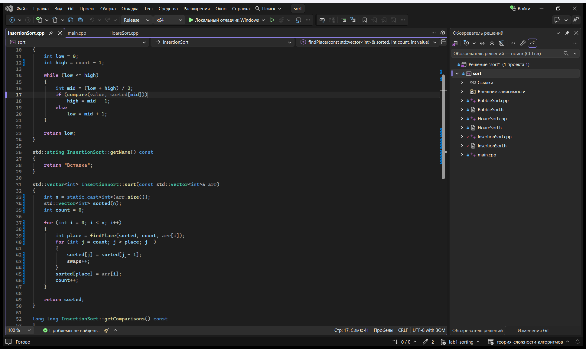
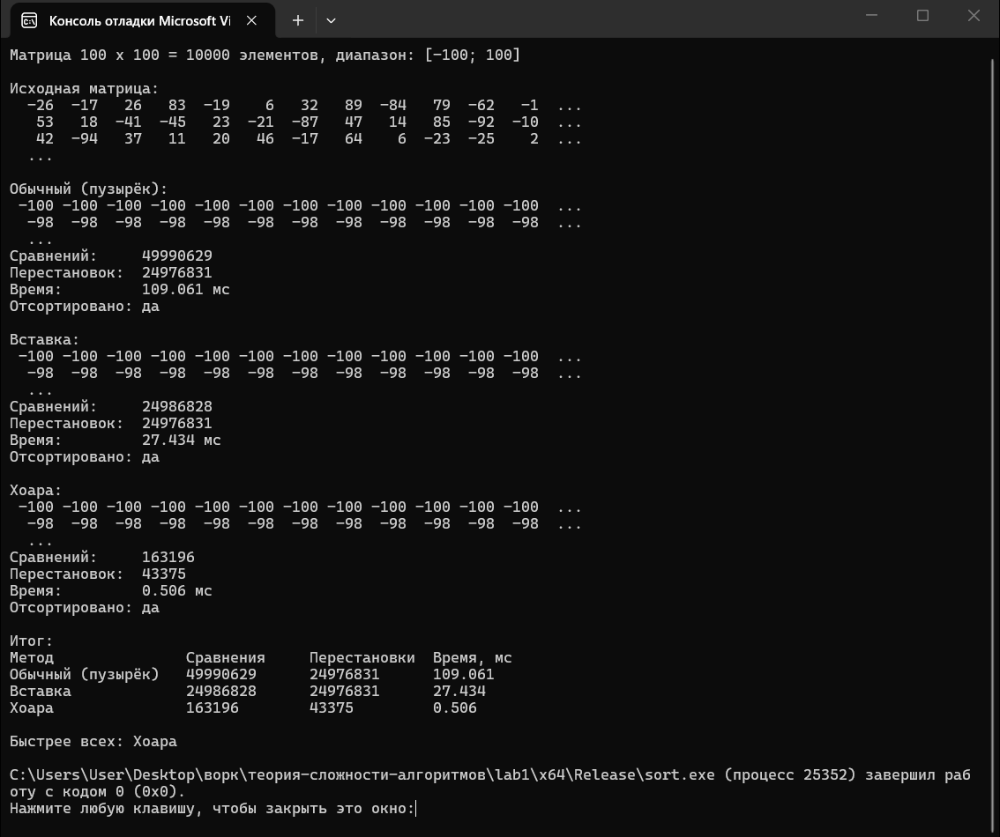

# Теория сложности алгоритмов

## Лабораторная 1. Сортировки

| Метод | Сравнения | Перестановки | Время, мс |
|---|---|---|---|
| Обычный (пузырёк) | 49995000 | 24935533 | 158.366 |
| Вставка | 24945523 | 24935533 | 13.145 |
| Хоара | 163009 | 43084 | 0.528 |

Быстрее всех метод Хоара: O(n log n) против O(n²) у пузырька и вставки.
